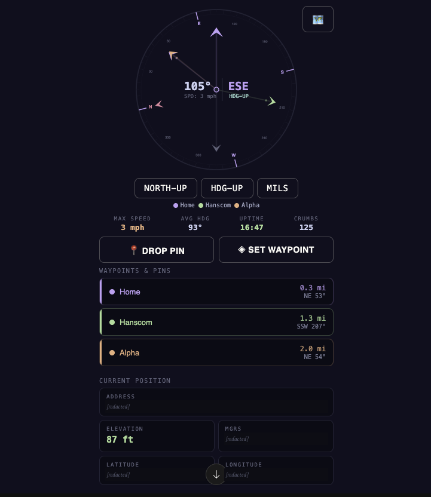

# Tactical GPS

> A dark, military-style Android navigation app: live compass, MGRS grid, lat/long, elevation, street address, waypoints and a "go to destination" arrow.

<p align="center"></p>

| Status | Version | Platform | Stack |
|---|---|---|---|
| In progress | 0.1.0 | Android (Flutter) | Dart · Flutter · Provider |

## Open it

- **Install on Android:** download the APK from the [latest release](https://github.com/CliffSolo/tacticalGPS/releases/latest) and allow "install unknown apps" on the phone.
- **Run from source:** install [Flutter](https://docs.flutter.dev/get-started/install), plug in a phone, then:
  ```bash
  flutter pub get
  flutter run
  ```
- **Clickable design prototype:** download `prototype/tactical_gps_v2.html` and open it in a browser (GPS data is simulated).

## Features

- **Compass rose** with heading in degrees and cardinal direction, North-up / Heading-up modes and a mils readout.
- **Current position cards:** MGRS grid, elevation (ft / m), latitude, longitude and street address (reverse geocoding).
- **Destination navigation:** enter an address, lat/lon or MGRS grid; a second arrow points to it with bearing ("Head 063°") and distance.
- **Waypoints and pins:** drop up to 3 of each, rename them, and see them on the compass rose at their true bearing.
- **Map screen** with OpenStreetMap tiles.
- **Trip stats:** max speed, average heading, uptime and breadcrumb count.
- **Keep screen on** toggle and a Catppuccin Mocha + tactical green theme.

## Project layout

```
lib/
├── main.dart
├── screens/      main_dashboard, navigation, map, settings
├── widgets/      compass_painter (custom-painted compass rose)
├── utils/        app_state (Provider), location_utils (bearing/distance), waypoint
└── theme/        Catppuccin colors
prototype/        tactical_gps_v2.html — single-file HTML design prototype
docs/             screenshot
android/ ios/ linux/ macos/ web/ windows/   Flutter platform folders
```

## Built with

`geolocator` (GPS), `flutter_compass` (magnetometer heading), `mgrs_dart` (MGRS conversion), `geocoding` (addresses), `flutter_map` + `latlong2` (map), `provider` (state), `wakelock_plus`, `permission_handler`.

## Roadmap

- [ ] Barometric altitude and height above ground (topographic data)
- [ ] Better accuracy (currently about ±44 m on some fixes)
- [ ] Distance units (ft / mi / km) and a recalibrate button
- [ ] Location history and saved markers
- [ ] Emergency signal button

See [CHANGELOG.md](CHANGELOG.md) for the full history.
